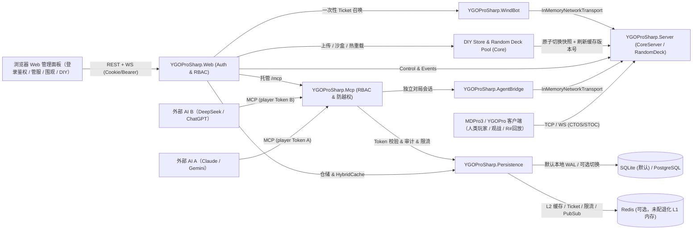
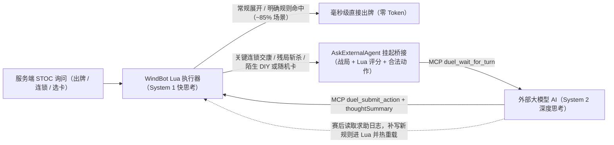

# AI MCP、随机卡组、数据库/Redis 缓存、Web 管理面板、DIY 与 Docker 规划文档

> 本文档为 **YGOProSharp** 的演进设计计划，仅描述目标架构、模块边界、数据与缓存模型、账号权限体系、接口契约与分阶段路线图，不代表当前仓库已实现全部功能。

## 1. 核心定位与目标

当前仓库已具备分层 DIY 资源加载（`expansions/`、`diy/`、`.cdb` 覆盖、`.ypk`/`.zip` 脚本包）、多房间路由（`CoreServer`）、房号规则解析（`RoomPasswordParser`）、房间聊天指令（`ChatCommandAddon` + CLI `/ai`）以及完整的 LuaLS API 声明（`YGOProSharp.Native/lua-api/`、`YGOProSharp.WindBot/lua-api/`）。

本规划坚持一条核心原则：**服务端只做纯粹的游戏服 + 控制面 + MCP Server，绝不内置任何大模型 API 客户端，也不托管任何模型 API Key**。所有 AI（Gemini、DeepSeek、ChatGPT、Claude 等）均作为**外部 MCP Client**，在**严格权限隔离**下接入服务端，重点服务以下核心玩法与工程目标：

1. **和外部 AI 对战 / 看 AI 斗蛐蛐（MCP 1v1 与 2v2 全模式对局）**：
   - **人机对战 / 人机双排（1v1 / 2v2 Tag Duel）**：人类用 MDPro3 / YGOPro 进房，外部 AI（Claude / Gemini / ChatGPT / DeepSeek 等）通过 MCP 以受限 `player` 身份进房——既可 1v1 单挑，也可在 **2v2 双打模式（`2V2#` / `T#`，默认 16000 LP）** 下与人类结成队友并肩闯关，或 2 人类对战 2 AI。
   - **AI 斗蛐蛐与 2v2 战队赛（外部 AI vs 外部 AI / 外部 AI + WindBot 混编）**：支持 2 个外部 AI 单挑，或 **4 个外部 AI 组成两支双人战队进行 2v2 双打博弈**（如 `Claude + Gemini` vs `DeepSeek + ChatGPT`，在不透视队友手牌的前提下纯靠场面信号与公共聊天配合），亦支持用 `/ai fill` 由内置 `WindBot` 补齐任意空位；人类可在 MDPro3 客户端或 Web 控制台实时围观，赛后自动保存兼容标准 `.yrp`（含 `REPLAY_TAG` 4 卡组序列）录像。
2. **MCP 创作 WindBot Lua 与「双脑思考决策」**：
   - 授权外部 AI 可通过 MCP 读取 `windbot-deck.lua` / `windbot-dialog.lua` API 与 `.ydk` 卡表，编写 xmake 风格 WindBot Lua 卡组与对话脚本，并通过服务端进程内闪电自博弈（`CreateLocalTransport`）获取决策复盘日志持续调优。
   - 支持 **纯 Lua 四层思考决策（零 Token、毫秒级）** 与 **双脑混合决策（WindBot Lua 快思考处理常规操作 + 关键交康/斩杀/陌生卡挂起求助外部 MCP AI 慢思考，赛后反哺写回 Lua）**。
3. **随机卡组娱乐与盲盒斗蛐蛐玩法**：
   - 内置服务端级随机卡组引擎，支持 **盲盒预组随机（Preset Random）**、**同卡组镜像内战（Mirror Random）**、**全卡池混沌组卡（Chaos Draft）** 与 **DIY 专属随机（DIY Random / DIY Chaos）**。
   - 人类玩家免配卡组进房点准备即可开打，外部 AI 无需手动拼凑卡密即可领盲盒上场（最适合测试不同大模型临场读卡与即兴操作能力）。
4. **双引擎数据库（默认 SQLite / 可选 PostgreSQL）与 Redis 多级缓存命中体系**：
   - 参考 `srvpro2`、`mycard/srvpro` 与 `EDOpro-server-ts`，将**只读卡片字典库（`cards.cdb`）**与**服务端运营数据库**彻底分离：单机默认零配置使用本地 `SQLite (WAL)`，生产/多实例一键切换 `PostgreSQL`；
   - 基于 `.NET HybridCache`（L1 进程内内存 + L2 `Redis`）构建高命中缓存、一次性入房/WS 票据（Ticket）与滑动窗口防爆破限流；未配 Redis 时自动退化为纯内存模式。
5. **多用户账号密码与细粒度 RBAC 管理面板**：
   - 吸收并升级 `mycard/srvpro` 的预设角色（`super_admin` / `judge` 裁判 / `diy_maintainer` / `ai_operator` / `streamer` 主播只读）+ 单用户细粒度权限集覆盖机制，密码强制 **Argon2id** 哈希，支持首次启动安全引导改密、防爆破锁定、IP 脱敏保护与全量审计。
6. **严格分级的 MCP 权限体系**：外部 AI 默认仅拥有最小权限（如 `player` 只能操作自己的对局会话、只能看到自己视角的公开与手牌信息），面板用户签发 MCP Token 严格遵循**权限不放大原则**。
7. **DIY 资源上传、单卡引擎沙盒与免重启热重载**：支持在网页（或授权 `diy_creator`/`admin` 的 MCP）上传与编辑 `.cdb`、`.lua`、`.ypk`/`.zip`、`lflist.conf`、`.ydk`，经 `Working Copy` 校验与 `ocgcore` 沙盒试跑后原子热重载。
8. **Docker 容器化与环境净化**：提供多阶段精简 `Dockerfile`、支持单机 SQLite 与 `PostgreSQL + Redis` Profile 的 `docker-compose.yml` 及 `.dockerignore`，非 root 最小权限运行。

---

## 2. 架构边界与项目布局

严格遵循 [AGENTS.md](../AGENTS.md) 中的仓库边界约束：

- **只向外组合，不反向污染核心层**：
  - `YGOProSharp.Core`、`YGOProSharp.Protocol`、`YGOProSharp.NativeApi`、`YGOProSharp.Server`、`YGOProSharp.WindBot` **均不引入** ASP.NET Core、HTTP Server 或 MCP SDK。
  - **全仓库不引入任何外部大模型 SDK**（不接入 OpenAI / Gemini / Anthropic / DeepSeek HTTP API，服务端不发起任何出站 LLM 请求）。
  - `.ydk` 序列化、预设卡组池筛选与混沌随机组卡算法放在 `YGOProSharp.Core`（仅依赖 `ICardRepository` / `Banlist`），不跨界触碰网络协议或 SQLite。
  - `SQLite` 卡片字典读取细节（含 DIY `.cdb` 校验与生成）严格收口在 `YGOProSharp.Core` 的 card DB manager 边界内；而**服务端运营数据库（SQLite / PostgreSQL）与 Redis 缓存**全部收口在独立基础设施项目 `YGOProSharp.Persistence` 内，绝不泄漏到 `Card`、`Deck`、`Game`、`Protocol` 或 `WindBot`。
  - 参考 `srvpro2` 与 `EDOpro-server-ts` 的解耦规范：不在 `Game` / `Player` 类内堆砌业务持久化字段或长生命周期引用，统一通过轻量房间事件（`OnDuelEnd`、`OnRoomFinalize` 等）驱动战报落库、云录像保存与缓存刷新；启动顺序严格保证「卡库/禁限表 → 数据库迁移与 Redis → 事件订阅插件 → WindBot 预检 → 最后开启网络监听端口」。
  - 日志统一经 `AppLog` / `ILogger`，禁止 `Console.Write*` 回流（尤其在 MCP `stdio` 模式下，`stdout` 必须独占用于 JSON-RPC 协议帧）。

### 建议新增项目布局

```text
YGOProSharp/
├── YGOProSharp.Abstractions/   # 现有：跨层契约、Ocg DTO、AppLog
├── YGOProSharp.Core/           # 现有：+ 热重载 Provider、DIY 包管理、YdkSerializer、PresetDeckPool、RandomDeckGenerator
├── YGOProSharp.Protocol/       # 现有：保持纯网络协议边界
├── YGOProSharp.NativeApi/      # 现有：保持唯一 native interop 边界
├── YGOProSharp.Server/         # 现有：+ 随机卡组规则/指令、猝死规则(ED)、停服维护开关、房间控制事件与快照 API
├── YGOProSharp.WindBot/        # 现有：+ LuaDeckExecutor 思考日志（EmitThought）与可选外部决策桥接钩子（AskExternalAgent）
├── YGOProSharp.Persistence/    # [新增] 运营数据基础设施（EF Core SQLite/PostgreSQL 双引擎 + HybridCache L1/Redis L2 + 限流/票据）
├── YGOProSharp.AgentBridge/    # [新增] 受限视角协议决斗代理（支持纯外部 AI 托管与 WindBot 双脑慢思考接管）
├── YGOProSharp.Mcp/            # [新增] 纯 MCP Server（Tool/Resource/Prompt + RBAC 鉴权 + stdio / Streamable HTTP）
├── YGOProSharp.Web/            # [新增] ASP.NET Core Minimal API + 面板用户认证/RBAC + WebSocket + /mcp + 静态前端托管
├── YGOProSharp.Cli/            # 现有：组合根，按严格启动顺序装配 server / persistence / web / mcp + NLua 沙箱加固
├── web/                        # [新增] 前端管理面板源码（Vite + TypeScript + React/Vue）
├── Dockerfile                  # [新增] 多阶段净化构建（native libocgcore.so + web + dotnet runtime）
├── docker-compose.yml          # [新增] 单机 SQLite 默认编排 + PostgreSQL/Redis 生产 Profile
└── .dockerignore               # [新增] 排除构建产物、参考仓、临时日志与敏感配置
```

### 系统拓扑图



---

## 3. 模块一：外部 AI MCP 接入与权限限制

### 3.1 传输模式（适配所有主流外部 AI 客户端）

服务端只暴露标准 **Model Context Protocol (MCP)**，外部任意支持 MCP 的工具或客户端（Claude Desktop / Claude Code、Gemini CLI、ChatGPT MCP Connectors、Cursor、Cline、Cherry Studio、DeepSeek / OpenAI Agent 等）均可直接连入：

| 传输方式 | 入口形式 | 适用场景 |
|---|---|---|
| **Streamable HTTP（推荐主力）** | `http://<host>:<webPort>/mcp`（Header 携带 `Authorization: Bearer <token>`） | **多 AI 斗蛐蛐必备**（可同时连接 2 个及以上外部 AI 客户端到同一台服），兼容 ChatGPT / Claude / Gemini / DeepSeek 各类 MCP 客户端与远程主机 |
| **stdio（本机轻量）** | `dotnet run --project YGOProSharp.Cli -- mcp --endpoint http://127.0.0.1:7912 --token <token>` | 适配仅支持本地 `stdio` 的桌面/CLI 客户端（轻代理转发至本机运行中的服务控制面，保证 `stdout` 零杂音） |

### 3.2 严格权限分级（RBAC 模型）

所有 MCP 连接**必须绑定角色与权限范围（Role / Scope）**，未授权工具甚至不会出现在该客户端的 `tools/list` 列表中（最小暴露面）：

| 角色 | 目标使用方 | 允许能力 | 明确禁止 |
|---|---|---|---|
| **`player`**（默认发给外部 AI） | 和人类玩的 AI、参与 1v1/2v2 斗蛐蛐的 AI | 查看公开房间列表、加入指定房间（可选限定允许房名白名单）、在 2v2 大厅切换队伍席位、提交卡组或一键请求随机卡组、准备/取消准备、**仅读取自己会话的战争迷雾局面（2v2 下可见己方共享场面暗牌，但严禁透视队友未公开手牌与队友里侧额外卡组）与合法动作**、读取自己本局卡组无序构筑清单、提交自己动作、在自己房间发言、投降（2v2 下发起/确认队友投降协商）/离房、查询公开卡库文本 | 禁止看对手或**2v2 队友未公开手牌/里侧额外**/随机卡组名、禁止读取牌堆顶底洗牌顺序、禁止操作其他 AI（含队友 AI）的会话、禁止踢人/关房/改服、禁止上传或删除 DIY |
| **`spectator`** | 外部 AI 解说员 / 只读观察 Agent | 查看公开房间列表、以观战者视角读取公开局面与双方 LP/回合/动作事件、查询公开卡库文本、可选在房间发观战解说 | 禁止坐上决斗者席位、禁止提交操作、禁止任何写操作与 DIY 修改 |
| **`diy_creator`** | 帮服主写 DIY 卡、卡脚本与 WindBot Lua AI 的外部 AI | 读取 `ygopro-core.lua` / `windbot-*.lua` API 文档、查询卡库/卡组/脚本、向指定沙箱写入 DIY 卡片/规则脚本/配套 `.ydk` 与 **WindBot Lua 卡组/对话脚本**、触发沙箱预检、热重载与**进程内闪电自博弈试跑** | 禁止踢人、禁止关房、禁止修改或删除其他非授权包、禁止查看管理 Token |
| **`admin`** | 站长自己的运维 AI（仅显式签发） | 具备 `spectator` + `diy_creator` + 房间管理（建房、改规则、切换随机卡组模式、管理随机卡组池、广播、召唤 WindBot、踢人、关房、查看服务状态与审计日志） | 仍**不能**通过 MCP 透视正在进行中的对局暗牌或洗牌牌序（保持对局公平原则） |

#### 会话绑定与防越权机制
- 当外部 AI 调用 `duel_join_room` 时，服务端为该 MCP 会话签发并绑定专属 `sessionId`，并在内存表记录 `(tokenId, mcpSessionId) -> AgentDuelSession`。
- 后续所有 `duel_get_observation`、`duel_get_legal_actions`、`duel_submit_action`、`duel_chat` 均强制校验调用方 Token 归属：
  - **AI A 永远无法读取或操作 AI B 的对局会话**；
  - 可选开启 **房间白名单限制**（签发某个 `player` Token 时限定 `allowedRooms: ["Arena01"]`，防止外部 AI 乱闯别的玩家房间）；
  - 可选开启 **单 Token 并发席位上限**（默认 `maxActiveSessions = 1`，防止一个外部 AI 刷满房间）。

### 3.3 按角色划分的 MCP Tools 清单

#### A. 对局玩家工具（`player` 角色可用 — 核心玩法）

| Tool 名称 | 说明 |
|---|---|
| `room_list` | 列出当前可加入/可观战的公开房间摘要（含房间规则与是否启用随机卡组模式） |
| `card_get` / `card_search` | 按卡密或卡名查询卡片效果文本（供 AI 理解场上、手牌或刚抽到的随机卡效果，支持 DIY 卡） |
| `duel_list_preset_decks` | 列出服务端提供的公开预设 `.ydk` 卡组池与随机卡组分类标签 |
| `duel_join_room` | 以普通玩家身份加入指定房间（或按密码规则创建/进入约定房间，如 `RD#Box01`、`2V2,RD#TagBox01`、`CHAOS#Fun01`），返回绑定的 `sessionId` 与分配槽位 `seatIndex`（2v2 下 `0/1` 为 A 队，`2/3` 为 B 队） |
| `duel_swap_seat` | 在 2v2（Tag）大厅未准备状态下切换空余席位/更换队伍（对齐房间内 `/swap` 指令） |
| `duel_set_deck` | 提交卡组：支持传预设卡组名、传 Main/Extra/Side 卡密数组，或直接传 `randomMode: "preset" \| "chaos" \| "diy"` 由服务端即时生成随机卡组（若房间本身已是强制随机房可省略此步） |
| `duel_set_ready` | 在大厅切换准备 / 取消准备（若自己是房主且全员就绪，可调用 `duel_start`） |
| `duel_wait_for_turn` | 长轮询等待直至轮到自己决策（猜拳、选先后攻、出牌、连锁询问、**2v2 下队友发起 `teammateSurrenderPending` 投降征询**；在**双脑模式**下仅在 WindBot Lua 触发关键点求助时唤醒，并附带求助原因与 Lua 初步评分）或对局结束，避免 AI 高频空转刷请求 |
| `duel_get_observation` | 读取**严格己方视角**的结构化局面：双方 LP、当前回合/阶段、2v2 队伍与当前执子槽位（`isTag`、`mySeat`、`teammateName`、`activeOperatorSeat`、`teammateSurrenderPending`）、己方手牌/额外（**2v2 非本人执子回合仅展示已公开卡及张数，严格隐藏队友暗手牌与里侧额外**）、己方共享怪兽/魔陷区（含队友盖卡详情）、墓地/除外区、**本人卡组主/额外的无序构筑清单**、对手仅公开区域的卡与手牌数量、最近公开对局日志 |
| `duel_get_legal_actions` | 读取当前等待响应的**编号化合法动作列表**（例如 `[0] 通常召唤 青眼白龙`、`[1] 发动 死者苏生`、`[2] 进入战斗阶段`、`[3] 取消连锁`），附带选择数量约束 |
| `duel_submit_action` | 提交所选合法动作编号（及必要目标编号），可选附带 `thoughtSummary`（仅展示在 Web 围观页思考气泡）或 `chatLine`（发到房间聊天框） |
| `duel_chat` | 在当前所在房间发送普通聊天（受频控限制，防止刷屏） |
| `duel_surrender` / `duel_leave` | 主动投降（**2v2 模式下首次调用向队友发送 `STOC_TEAMMATE_SURRENDER` 征询，队友亦调用后正式认输**）或离开当前房间并释放会话 |

#### B. 观战与查询工具（`spectator` 及以上可用）

| Tool 名称 | 说明 |
|---|---|
| `room_list` | 列出所有公开活动房间 |
| `room_get_public_state` | 读取指定房间观战视角的公开场面、双方 LP、回合数、双方公开卡组模式标签、最近公开动作事件流与聊天 |
| `card_search` / `card_get` / `banlist_list` | 查询卡库与禁限表 |

#### C. DIY 与 WindBot Lua 创作工具（`diy_creator` / `admin` 可用）

| Tool 名称 | 说明 |
|---|---|
| `diy_list_packages` | 查看已安装 DIY 包状态、优先级与包含文件 |
| `diy_upsert_card` | 向授权 DIY 包写入/更新单张卡片数据（默认 `ot=4`，自动联动特殊召唤位与 `strings.conf` 字段/指示物；开启审阅模式时生成待确认 Proposal） |
| `diy_write_script` | 写入 `c<code>.lua` 或全局规则脚本并执行静态安全与语法预检（支持审阅 Proposal 模式） |
| `diy_test_card_sandbox` | 参考 `YGODIY` 沙盒思路，基于 `YGOProSharp.NativeApi` 在进程内创建微型残局/情景沙盒，实测加载该 DIY 卡的 `initial_effect`、发动检查与处理函数无引擎报错 |
| `diy_save_deck` | 向授权 DIY 包写入配套 `.ydk` 主题卡组（热重载后自动加入 DIY 随机盲盒池） |
| `diy_update_banlist` | 更新 DIY 包内的 `lflist.conf` |
| `diy_reload` | 触发分层资源与随机卡组池原子热重载 |
| `deck_inspect` | 解析指定 `.ydk` 预设/Bot 卡组，批量返回每张卡的卡密、卡名、效果文本与属性星级（供 AI 分析 Combo 与写 Lua） |
| `windbot_list_lua_scripts` | 列出已加载的 WindBot Lua 卡组执行器与对话脚本 |
| `windbot_write_deck_script` | 向受管沙箱写入 WindBot Lua 卡组脚本，执行 **NLua 沙箱静态检查 + DSL 干跑预检** 并热加载 |
| `windbot_write_dialog_script` | 向受管沙箱写入配套 WindBot Lua 对话脚本（支持多语言 `locale(...)`） |
| `windbot_simulate_match` | 在进程内纯内存（`CreateLocalTransport`）毫秒级试跑 1~5 局对战，返回 **决策复盘报告（Decision Trace）**：异常栈、每回合触发规则、卡手未动牌（Dead Cards）、回退默认次数、双方 LP 与胜负 |

#### D. 管理员工具（仅 `admin` 可用）

| Tool 名称 | 说明 |
|---|---|
| `server_get_status` | 查看服务监听、连接数、房间数、卡组池与 DIY 资源加载统计 |
| `room_create` / `room_update_rules` / `room_close` | 预建房（支持指定盲盒/混沌/镜像随机模式）、在大厅实时改规则、关闭房间 |
| `room_kick_player` / `room_broadcast_message` | 踢出玩家、发送系统公告 |
| `room_spawn_windbot` / `bot_list_decks` | 向指定房间召唤内置 WindBot（支持指定卡组或 `random: true` 随机抽取机器人可用卡组） |
| `diy_toggle_package` / `diy_delete_package` | 启停、调整优先级或删除 DIY 包 |

### 3.4 MCP Resources 与 Prompts

- **Resources**：
  - `ygopro://guide/duelist-protocol`：面向外部 AI 的简明打牌操作指南（含普通构筑局与随机盲盒/混沌局的查卡与检索技巧）。
  - `ygopro://rooms/public`：当前公开房间实时快照。
  - `ygopro://api/ocgcore-lua`：映射 [YGOProSharp.Native/lua-api/ygopro-core.lua](../YGOProSharp.Native/lua-api/ygopro-core.lua)（仅 `diy_creator` / `admin` 重点使用，防止写 DIY 卡脚本产生 API 幻觉）。
  - `ygopro://guide/diy-effect-patterns`：参考 [YGODIY](https://github.com/YYY-ZSJ/YGODIY) 的结构化效果语义总结（发动条件 / 代价 / 取对象 / 处理四槽对齐、卡名一回合一次计数、`TYPE_SPSUMMON` 卡表位与 `aux.Stringid` 编号规范），降低外部 AI 编写实卡级 Lua 的裁定偏差。
  - `ygopro://api/windbot-lua`：映射 [YGOProSharp.WindBot/lua-api/windbot-deck.lua](../YGOProSharp.WindBot/lua-api/windbot-deck.lua) 与 [windbot-dialog.lua](../YGOProSharp.WindBot/lua-api/windbot-dialog.lua)（明确包含 `WindBotCardList` 0-based 下标与 60+ `DefaultRuleName` 声明）。
  - `ygopro://examples/windbot-lua-deck`：映射 [YGOProSharp.WindBot/Decks/Lua/ExampleBlueEyes.lua](../YGOProSharp.WindBot/Decks/Lua/ExampleBlueEyes.lua) 作为标准 xmake 风格 DSL 编写范本。
- **Prompts**：
  - `play-duel-room`：引导外部 AI（Claude / Gemini / ChatGPT / DeepSeek）进入指定房间、选卡组（或适配房间随机卡组规则）并规范完成整局对决。
  - `create-diy-card`：引导授权 AI 按真实 `ygopro-core.lua` 签名生成并发布 DIY 卡片与配套测试卡组。
  - `author-windbot-lua`：引导授权 AI 走完「读 `.ydk` 卡表效文 → 按四层思考决策架构写 Lua → 沙箱预检 → `windbot_simulate_match` 内存试跑 → 看 Decision Trace 迭代调优」完整闭环。

---

## 4. 模块二：受限视角协议代理与「AI 斗蛐蛐」体验设计

核心模块 `YGOProSharp.AgentBridge` 负责把外部 MCP 工具调用桥接为标准 YGOPro 玩家连接：

### 4.1 典型对战场景流程

1. **人类 vs 外部 AI（和 AI 玩）**：
   - 玩家在 MDPro3 进房（如普通房 `DIY,MR5#MyRoom` 或随机盲盒房 `RD#MyRoom`），复制一个 `player` Token 交给外部 AI。
   - 外部 AI 通过 MCP 自动进房、准备，双方像正常联机一样完成整局对决；AI 还可以通过 `duel_chat` 边打牌边互动。
2. **外部 AI vs 外部 AI（AI 斗蛐蛐）**：
   - 房主在 Web 控制台点「创建斗蛐蛐房」（支持勾选 **自选构筑 / 随机盲盒预组 / 镜像同卡组内战 / 混沌全卡池随机**，默认开启较宽松的单步回合时间如 `Timer=300s`），自动生成两枚独立 `player` Token（`Token-A` 与 `Token-B`）。
   - 两个外部 AI 客户端（如左侧 Claude Code、右侧 Gemini CLI / DeepSeek）各自连接 `/mcp` 并加入该房互搏。
   - **镜像随机斗蛐蛐（`RDM#Cricket01`）** 尤其适合公平对比两个大模型的牌力：双方在开局拿到完全相同的随机卡组，纯粹比拼阅读理解与资源运营！
   - 人类玩家既可以用 **MDPro3 客户端直接连入房间观战**，也可以在 **Web 控制台实时围观页** 看双方 LP 变化、场上卡片摘要、本局各自抽到的随机卡组名、出牌时间轴与 AI 思考气泡。
3. **外部 AI vs 内置 WindBot（AI 挑战机器人）**：
   - Web 控制台或聊天指令 `/ai random` 先把携带随机适配卡组的内置 WindBot 拉进房间，再让外部 AI 通过 MCP 加入空余席位即可直接开打。
4. **2v2 双打模式（Tag Duel — 人类 / 外部 AI / WindBot 四席自由混编）**：
   - 房号设为 `2V2#TagArena`（或 `T#TagArena`、`2V2,RD#TagBlindBox`），默认初始 `LP = 16000`；任意组合人类、外部 MCP AI、内置 WindBot 占满 4 个席位（A 队 `#0/#1` vs B 队 `#2/#3`）即可开局（详见 4.4 节）。

### 4.2 协议可靠性与防卡死保护（不依赖内置大模型）

- **全消息合法动作翻译**：覆盖 `MSG_IDLE`、`MSG_BATTLE`、`MSG_SELECT_CARD`、`MSG_SELECT_CHAIN`、`MSG_SELECT_EFFECTYN`、`MSG_SELECT_YESNO`、`MSG_SELECT_POSITION`、`MSG_SELECT_OPTION`、`MSG_SELECT_PLACE`、`MSG_SELECT_TRIBUTE`、`MSG_SELECT_SUM`、`MSG_SELECT_UNSELECT_CARD`、`MSG_SELECT_COUNTER`、`MSG_SORT_CARD`，统一编号输出并严格校验 AI 提交的索引合法性，非法请求直接返回可读错误提示让外部 AI 重选，绝不发送损坏二进制包。
- **可选自动跳过无意义选择**：针对仅剩 1 个唯一选项或简单顺序确认的提示，可配置自动确认以减少外部 AI 往返轮次，加快斗蛐蛐节奏。
- **断线与超时代管保护**：若某个外部 AI 超过约定时间未调用 `duel_submit_action`（如客户端崩溃或用户中断），支持配置「超时自动安全兜底（取消连锁 / 结束阶段）」或按房间正常计时判负，确保房间不会永久僵尸占用。
- **长轮询防刷**：`duel_wait_for_turn` 内部阻塞等待状态信号（带可配置超时，如 25 秒返回一次心跳），避免外部 AI 疯狂轮询浪费上下文。

### 4.3 WindBot Lua 创作闭环与「双脑混合思考决策」架构

结合仓库已有的泛用 `LuaDeckExecutor`（xmake 风格 DSL，见 [docs/windbot-lua.md](windbot-lua.md)）、内置 NLua 5.4（[NLuaRuntime.cs](../YGOProSharp.Cli/NLuaRuntime.cs)）与进程内零端口直连（`CreateLocalTransport()`），打通外部 AI 编写 WindBot Lua 脚本与分级思考决策：

#### 4.3.1 MCP 驱动 WindBot Lua 编写与闪电自博弈闭环
1. **读 API 与卡组效文**：外部 AI 先读 `ygopro://api/windbot-lua`（含 CLR `0-based` 列表约定与 60+ `DefaultRuleName`）及 `ygopro://examples/windbot-lua-deck`，再调用 `deck_inspect` + `card_get` 逐卡分析展开链、终场与阻抗点，杜绝卡密与 API 幻觉。
2. **NLua 沙箱加固与 DSL 干跑预检**：调用 `windbot_write_deck_script` / `windbot_write_dialog_script` 时，在受限 `NLuaScriptContext` 中清空 `os`、`io`、`package`、`debug`、`dofile`、`loadfile`、`require`、`luanet`，启用指令数/单步超时熔断（防死循环），并干跑 `DoString` 验证语法、`deck(...)` 声明、`DefaultRuleName` 与底部延迟解析函数名。
3. **进程内毫秒级自博弈复盘（`windbot_simulate_match`）**：使用 `YGOProSharpServerHost.CreateLocalTransport()` 在纯内存零延迟跑完 1~5 局实战（如新 Lua AI vs `ExampleBlueEyes` / 镜像自博弈），回传精简 **Decision Trace**：Lua 异常栈、每回合触发规则、直到对局结束仍未动过的卡手牌（Dead Cards）、回退默认逻辑次数、双方 LP 与胜负，供外部 AI 自主修复与迭代优化。

#### 4.3.2 纯 Lua 内部「四层思考决策架构」（System 1 快思考 — 零 Token、毫秒级）
通过 `author-windbot-lua` Prompt 引导外部 AI 将 WindBot Lua 组织为四层结构，而非零散 `if` 堆砌：
1. **局面黑板（Turn Blackboard）**：在 `on_init` / `on_new_turn` / `on_chaining` / `on_move` 中记录本回合已用「卡名一回合一次」效果、已通召标记、对手亮过的手坑与墓地阻抗。
2. **宏观战术判定（Macro Plan）**：实时评估当前处于 `build_board`（先攻做场）、`break_board`（后攻解场）还是 `lethal`（结合 `Util:GetTotalAttackingMonsterAttack(0)` 与对手 LP 判定斩杀）。
3. **效用打分器（Heuristic Scoring）**：在 `on_select_card`、`on_select_chain`、`on_battle` 中按威胁分/收益分动态选择目标，未覆盖场景返回 `nil` 优雅回退 `DefaultExecutor`。
4. **思考过程可视化（Thought Trace）**：在 `LuaDeckExecutor` 新增轻量级 `ctx:EmitThought(summary)`（同步记录到 `AppLog` 与观战事件总线），让 Web 围观页与自博弈复盘都能直接看到 Lua AI 每一步的决策理由。

#### 4.3.3 「双脑混合思考决策」与赛后进化飞轮（System 1 + System 2）



- **高价值节点按需慢思考**：在 `LuaDeckExecutor` 提供可选桥接方法 `ctx:AskExternalAgent(reason, candidates)`；日常展开与明确攻击由 Lua 毫秒级处理（省下 80%+ Token 与等待时间），仅在关键交康、残局斩杀、或面对随机/DIY 陌生卡时挂起并把战局与 Lua 初步打分推送给外部 MCP AI 决策（超时自动回退 Lua 默认逻辑，绝不卡死对局）。
- **赛后进化飞轮**：对局结束后，拥有 `diy_creator` 权限的外部 AI 可拉取本局的求助记录，把新总结出的应对规则直接补写回对应 WindBot Lua 脚本并热重载——让外部大模型充当教练，越打 WindBot Lua 越强。

### 4.4 2v2 双打（Tag Duel）协议状态机、战争迷雾与组队协同设计

对照 `ocgcore`（`DUEL_TAG_MODE` / `MSG_TAG_SWAP`）、YGOPro `tag_duel.cpp`、`srvpro2`（`TagSurrenderConfirmMiddleware` / `DuelRecord`）及 `WindBot` 客户端协议预期，服务端原生完整支持 **2v2 双打（`Mode = 2`）**：

#### 4.4.1 四大高可玩性 2v2 场景
1. **人类 + 外部 AI 双排闯关**：1 名人类玩家与 1 个外部大模型（如 Claude / Gemini）组成 A 队，对战 B 队的两名人类、两个外部 AI 或两台内置 WindBot；双方共享场上怪兽/魔陷区、墓地与 16000 LP，可通过房间聊天讨论战术配合。
2. **4 大模型 2v2 战队斗蛐蛐**：在 Web 面板一键创建「2v2 战队斗蛐蛐房」，签发 4 枚独立 `player` Token（如 `[Claude + Gemini]` vs `[DeepSeek + ChatGPT]`），考验不同模型在**无法偷看队友暗手牌**条件下的场面留怪、后场盖卡与资源接力默契。
3. **1 人类 + 3 WindBot 秒开局**：人类进 `2V2#Room` 后输入 `/ai fill [卡组名]`，服务端自动填满剩余 3 个席位（1 名 AI 队友 + 2 名 AI 对手），单人即可随时体验 2v2 双打。
4. **大厅自由换队与席位编排**：支持客户端点击切席或输入 `/swap`（MCP 调用 `duel_swap_seat`）在 A 队（`#0, #1`）与 B 队（`#2, #3`）空位间自由调整搭档。

#### 4.4.2 严格对齐引擎与客户端的 2v2 关键机制（已在 `YGOProSharp.Server` 落地）
- **先攻换边与标准 `0 -> 2 -> 1 -> 3` 四席轮转**：
  - 仅由两队一号位（大厅 `#0` 与 `#2`）代表全队猜拳与选择先后攻；若 B 队先攻则自动标记 `IsDuelSwapped = true` 映射双方阵营，观战端同步下发 `MSG_START(0x11)` 保证画面上下阵营与聊天发言人序号（`pos ^ 2`）完全对齐。
  - 开局时先攻队 `#0` 与后攻队 `#3`（Turn 1 期间持手牌待命响应手坑）使用 `AddCard`，先攻队 `#1` 与后攻队 `#2` 使用 `AddTagCard`；Turn 2 开始时 `ocgcore` 自动触发 `MSG_TAG_SWAP(1)` 将后攻队 `#2` 换入首发，实现标准 **`先攻#0 -> 后攻#2 -> 先攻#1 -> 后攻#3`** 四人轮转。
- **`.yrp` 4 卡组录像兼容**：按 YGOPro `replay_mode` 标准规范写入 4 名玩家昵称（`[0, 1, 2, 3]`）与 `[0, 1, 3, 2]` 卡组装填序列并置位 `Replay.FlagTag`，确保 MDPro3 / YGOPro 客户端 100% 正常回放 2v2 录像。
- **2v2 队友战争迷雾铁律（防作弊隔离）**：
  - **共享可见**：己方共享怪兽区（`MonsterZone`）、魔陷区（`SpellZone`，含队友盖放的陷阱/速攻魔法）、墓地与表侧除外区对同队双人完全公开；
  - **严格保密**：`MSG_DRAW`、`MSG_TAG_SWAP` 与 `MSG_UPDATE_DATA(Hand / Extra)` 仅向当前执子玩家发送真实卡密，**同队非执子队友与对手、观战者一样仅收到遮蔽后的 `0`（除非卡片带有 `0x80000000` 公开标记或表侧灵摆）**，从协议根源杜绝外部 MCP AI 透视队友手牌。
- **队友投降双重确认（`STOC_TEAMMATE_SURRENDER`）**：
  - 2v2 对局中某玩家首次发起投降时，服务端暂不判负，而是向同队两人下发 `STOC_TEAMMATE_SURRENDER`（内置 `WindBot` 收到后会自动复议投降以配合人类队友；人类或外部 MCP AI 可在当回合点击投降确认，跨回合未确认自动重置）。

---

## 5. 模块三：随机卡组玩法设计（盲盒预组 / 镜像内战 / 混沌构筑）

为了让人类娱乐局与 AI 斗蛐蛐更具可玩性和节目效果，在 `YGOProSharp.Core` 与 `YGOProSharp.Server` 内原生设计完整的**服务端随机卡组体系**。

### 5.1 四种随机卡组模式

| 模式枚举 | 房号关键字 | 组卡逻辑与特点（含 1v1 与 2v2 适配） | 推荐场景 |
|---|---|---|---|
| **`PresetRandom`（盲盒预组）** | `RD` / `RAND` | 从服务端预设卡组池（`decks/random/*.ydk` + 已启用 DIY 包内 `decks/*.ydk`）中筛选符合当前房间 `Region` 与 `Banlist` 的 `.ydk` 随机抽取，**1v1 为 2 人、2v2（`2V2,RD#`）为 4 人尽量分配互不重复的卡组**。 | 人类盲盒娱乐局、2v2 异构卡组盲盒双打、AI 斗蛐蛐测卡组理解 |
| **`MirrorRandom`（镜像盲盒内战）** | `RDM` / `MIRROR` | 1v1 下令双方持有 100% 相同随机卡组；**2v2（`2V2,RDM#`）下抽取 `(Deck X, Deck Y)` 两套随机构筑，令 A 队 `#0/#1` 与 B 队 `#2/#3` 持有完全对称的双卡组组合**（各自独立洗牌）。 | **1v1 / 2v2 AI 战队最公平牌力评测**、好友对称双打技术战 |
| **`ChaosDraft`（全卡池混沌构筑）** | `CHAOS` | 直接从当前已加载卡库（`ICardRepository`，自动包含热重载后的扩展卡）按可玩性配比实时为每位玩家（1v1 2 套 / 2v2 4 套）生成主卡组（默认 40 张）+ 额外卡组（默认 15 张）。 | 戏剧性拉满的 1v1 / 2v2 四人混沌大乱斗、纯考外部 AI 即兴读卡配合 |
| **`DiyRandom` / `DiyChaos`（DIY 专属随机）** | `DIYRD` / `DIYCHAOS` | 自动将房间 `Region` 设为 `DIY(3)`，优先/仅从已启用 DIY 包的配套 `.ydk` 卡组或 `ot=4` DIY 卡池中生成卡组（支持叠加 `2V2,DIYRD#` 四人测试新卡）。 | 新上传一批 DIY 卡后立即拉人类或 AI 进房实测新卡节目效果 |

#### 混沌模式（`ChaosDraft`）可玩性保底配比算法
若完全均匀随机抽 40 张卡，极易抽到大量无法通召的高星/仪式/特定融合怪兽导致双方连续空过。`RandomDeckGenerator` 默认内置 **平衡构筑权重档（Balanced Chaos Profile）**（亦可通过 `PURECHAOS` 切换纯无保底真随机）：
- **非法卡硬过滤**：自动排除 `CardType.Token`（衍生物）、非法辅助条目，并按房间 `Region`（OCG / TCG / DIY）与当前 `Banlist`（禁卡 0 张、限一 1 张、准限 2 张、其余按 `Alias` 同名最多 3 张）严格控量。
- **主卡组平滑配比（默认 40 张）**：
  - **下级通常/效果/灵摆怪兽（Level ≤ 4，非仪式）**：约 **18~20 张（45%~50%）**，确保前几回合大概率有怪可通常召唤与攻防交互；
  - **上级怪兽（Level ≥ 5，非仪式，自动优先排除硬性不可通召的特殊召唤怪）**：约 **4~5 张（10%~12%）**；
  - **魔法卡（优先排除纯绑定专属仪式的废件仪式魔法）**：约 **9~10 张（22%~25%）**；
  - **陷阱卡**：约 **7~8 张（18%~20%）**。
- **额外卡组均衡填充（默认 15 张）**：按融合 / 同调（若主卡组含调整怪兽则提高同调权重）/ 超量（匹配主卡组常见星级如 R4）/ 连接（优先通用素材 Link 怪兽）混合抽取，让混沌局经常能搓出意想不到的额外大哥！

### 5.2 多入口触发交互（人类 / 房主 / 外部 AI / WindBot 全打通）

1. **房号密码前缀一键开房（扩展 `RoomPasswordParser`）**：
   - `RD#Room01`：盲盒预组随机房；
   - `RDM#Room01`：镜像同卡组盲盒房；
   - `CHAOS#Room01`：40+15 平衡混沌随机房（`CHAOS60#Room01` 可指定 60 张割草混沌局，`PURECHAOS#Room01` 为纯无保底真随机）；
   - `DIYRD#Room01` / `DIYCHAOS#Room01`：DIY 专属盲盒 / DIY 混沌大乱斗房。
2. **房间内聊天命令（扩展 `ChatCommandAddon`）**：
   - **房主全局开关**：`/randmode <off|preset|mirror|chaos|purechaos|diy|diychaos>` —— 在大厅切换全房强制随机模式，实时重置准备状态并向全房广播。
   - **玩家个人抽卡组指令**：`/randdeck [preset|chaos|diy]` —— **即使在普通构筑房间**，不想配卡组的单个玩家也可输入 `/randdeck` 单独给自己生成一套服务端随机卡组（不强制对手也随机），私聊回执展示抽到的卡组概览。
   - **内置 WindBot 随机卡组联动**：`/ai random` —— 从内置 `WindBot` 已实现 AI 出牌逻辑的机器人卡组列表中随机挑一套入场（注意区分：**内置 `WindBot` 依赖专用 C# 出牌脚本，因此仅从其支持的 AI 卡组池随机；而人类玩家与外部 MCP 大模型 AI 可驾驭任意预设盲盒与全卡池混沌卡组**）。
3. **外部 MCP AI 调用**：
   - 若进入 `RD#` / `CHAOS#` 强制随机房，外部 AI 直接 `duel_set_ready` 即可，开局后通过 `duel_get_observation` 中的 `myDeckList` 获知本局分配到的全部卡名；
   - 若在普通房间，外部 AI 可调用 `duel_set_deck(randomMode="preset" | "chaos")` 一键领随机卡组。
4. **Web 控制台建房与卡组池管理**：
   - 建房弹窗直接提供随机卡组模式下拉框与卡组池标签筛选（如「主流竞技池」「怀旧娱乐池」「DIY 扩展池」）；
   - 支持拖拽上传 `.ydk` 或 `.zip` 卡组包进入服务端随机盲盒池。

### 5.3 客户端协议兼容与防踩坑细节（关键工程落地保障）

结合 `YGOProSharp.Server` 现有协议流（`Game.SetReady`、`Game.TpResult`、`Player.OnUpdateDeck`），随机卡组在服务端落地的核心保障如下：

1. **客户端免改本地 `.ydk` 即可准备**：
   - 当房间启用强制随机模式，或某玩家已通过 `/randdeck` 挂载了服务端随机卡组标记时，玩家在 MDPro3 / YGOPro 客户端无论当前选中什么本地卡组（哪怕空卡组或禁卡表不符），点击「准备」时服务端自动跳过客户端提交的原卡组拦截。
2. **决斗启动时原生协议无缝同步**：
   - 在 `Game.TpResult` 创建 `IDuelSession` 时，服务端按房间随机模式生成最终 `Deck` 实例写入 `_duel.AddCard(...)` 与 `Replay`，随后发送标准 `GameMessage.Start`、`RefreshExtra(0/1)` 与 `_duel.Start(opt)`（触发初始 `MSG_DRAW`）。
   - **MDPro3 / YGOPro 客户端完全依赖服务端下发的 `RefreshExtra`、`MSG_DRAW` 与检索消息渲染手牌、额外与卡组选择列表**，无需修改任何客户端文件即可流畅操作服务端随机卡组！
3. **防剧透私聊播报与观战公开**：
   - 开局发牌瞬间，服务端通过 `SendSystemMessage` **仅向各玩家本人私聊**播报本局抽到的卡组信息（例如 `[RandomDeck] 本局盲盒卡组：闪刀姬 (Main 40 / Extra 15)`，对手不可见；若为 `MirrorRandom` 镜像局则向全房公开广播本局公共卡组名）；Web 围观面板和观战席可查看双方盲盒标签。
4. **Match 模式（BO3）换副阶段（`GameState.Side`）兼容**：
   - 在标准协议中，Match 第一小局结束后进入 `GameState.Side`，客户端会基于自己本地 `.ydk` 提交 `CTOS_UPDATE_DECK`，若走常规 `Deck.Check(deck)` 比对服务端随机卡组必然触发 `ErrorMsg(3)` 报错卡死。
   - 因此在随机卡组模式下，服务端针对 Match 模式自动采用兼容策略：支持配置 **「每小局重新随机分配新卡组（Re-roll per Duel，默认）」** 或 **「整场 Match 沿用首局随机卡组」**，在收到客户端换副确认包时直接放行并进入下一小局，彻底规避换副校验冲突。
5. **`.yrp` 录像 100% 完整回放**：
   - 随机生成的实际主卡组与额外卡组卡密在 `Game.TpResult` 中如实写入 `Replay` 头部，赛后下载 `.yrp` 用 MDPro3 / YGOPro 回放时完全一致，不会出现卡密错位。

---

## 6. 模块四：数据库（SQLite / PostgreSQL）、Redis 缓存命中与面板账号权限设计

本模块综合对照了四个参考服务端架构（见 [docs/reference-projects.md](reference-projects.md)）：
- **[purerosefallen/srvpro2](https://github.com/purerosefallen/srvpro2)**：`TypeormFactory`（PostgreSQL + 软删除 `softDelete` + `DuelRecordEntity` 云录像 `R#<id>` + `LegacyBanEntity` / `LegacyDeckEntity` / `LegacyApiRecordEntity`）与 `AragamiService`（配置 `REDIS_URL` 走 Redis，留空自动退化内存缓存）；
- **[purerosefallen/srvpro](https://github.com/purerosefallen/srvpro) & [mycard/srvpro](https://github.com/mycard/srvpro)**：`ygopro-auth` 的预设角色模板（`sudo` / `judge` / `streamer`）+ 单用户布尔权限集覆盖（`get_rooms`、`kick_user`、`ban_user`、`shout`、`start_death`、`stop`、`deck_dashboard_*`）以及客户端 `昵称$密码`（`vpass`）玩家身份识别；同时**彻底淘汰其早期 JSON 明文存密与 URL Query 传密的历史缺陷**；
- **[diangogav/EDOpro-server-ts](https://github.com/diangogav/EDOpro-server-ts)**：将**只读卡片 SQLite（`cards.cdb`）**与**业务关系库 PostgreSQL** 物理分离、Redis 一次性握手/入房票据（`Ticket`）与分级滑动窗口限流（`RATE_LIMIT`）、以及 SHA-256 + `FixedTimeEquals` 常量时间密钥比对防时序侧信道。

### 6.1 双引擎关系型数据库（默认 SQLite，可选一键切换 PostgreSQL）

在独立项目 `YGOProSharp.Persistence` 中通过 EF Core 封装双 Provider（`DbProvider=Sqlite | Postgres`），共用同一套领域仓储接口与启动自动迁移（Migrations）：

| 模式 | 配置示例 | 定位与工程细节 |
|---|---|---|
| **`Sqlite`（默认开箱即用）** | `DbProvider=Sqlite` `DbConnectionString="Data Source=data/db/ygoprosharp.db"` | 零外部组件负担；启动自动开启 `PRAGMA journal_mode=WAL; PRAGMA foreign_keys=ON; BusyTimeout=5000`，读不阻塞写，完全满足个人服、测试服与中小型社区服。 |
| **`Postgres`（高并发/多实例）** | `DbProvider=Postgres` `DbConnectionString="Host=postgres;Port=5432;Database=ygoprosharp;..."` | 基于 `Npgsql.EntityFrameworkCore.PostgreSQL`（推荐 PostgreSQL 16/17），支持 `JSONB` 审计检索、高并发战报写入与多游戏节点共享账号/封禁/录像库。 |

#### 核心数据表规划（全表统一支持 `created_at`、`updated_at` 与 `srvpro2` 风格 `deleted_at` 软删除）

| 表名 | 职责与关键字段 | 参考来源与升级点 |
|---|---|---|
| `panel_users` | 管理面板账号：`id`(UUID)、`username`(唯一)、`display_name`、`password_hash`(**Argon2id**)、`enabled`、`must_change_password`、`failed_login_count`、`locked_until`、`permissions_override_json`(可选单用户权限覆盖)、`last_login_at`、`last_login_ip` | 升级自 `mycard/srvpro` `admin_user.json`，淘汰明文密码 |
| `panel_roles` / `panel_user_roles` | 预设与自定义角色定义：`code`(`super_admin`/`judge`/`diy_maintainer`/`ai_operator`/`streamer`)、`name`、`permissions_json`(权限码列表) | 吸收 `mycard/srvpro` 角色模板 + 自定义组合 |
| `panel_sessions` | 面板登录会话：`id`、`user_id`、`refresh_token_sha256`、`ip`、`user_agent`、`expires_at`、`revoked_at` | 支持查看在线设备、改密踢出其他设备、超管强制下线 |
| `mcp_tokens` | 外部 AI 接入令牌：`id`、`owner_user_id`、`name`、`token_prefix`、`token_sha256`(仅存单向哈希)、`mcp_role`、`allowed_rooms_json`、`max_sessions`、`require_approval`、`expires_at`、`revoked_at`、`last_used_at` | 常量时间哈希比对参考 `EDOpro-server-ts` |
| `player_profiles` | 可选游戏客户端玩家档案（兼容 `昵称$密码` `vpass`）：`player_name`、`vpass_hash`、`client_key`、`chat_color`、`win_count`、`lose_count`、`flee_count`、`win_combo` | 吸收 `srvpro` `User` & `RandomDuelScore` |
| `duel_records` / `duel_record_players` | 对局战报与云录像：`id`、`room_name`、`room_identifier`、`mode`(`0/1/2` 含 2v2 Tag)、`host_info_json`、`random_deck_mode`、`duel_count`、`win_reason`、`seed`、`yrp_path`、**2 或 4 席玩家明细**（`seat_index 0..3`、`team_id 0..1`、`real_name`、`seat_type`[人类/WindBot/MCP AI]、`start_deck`、`ingame_deck`、`winner`） | 吸收 `srvpro2` `CloudReplayService`，完整支持 1v1 与 2v2 `R#<id>` 直接回放 |
| `bans` | 封禁记录：`id`、`target_type`(`ip`/`cidr`/`name`/`client_key`)、`target_value`、`reason`、`flee_count`、`expires_at`、`created_by` | 吸收 `srvpro` `Ban` / `RandomDuelBan` 与 `srvpro2` `LegacyBanEntity` |
| `tournament_decks` | 比赛交牌表：`tournament_tag`、`player_name`、`ydk_content`、`deck_hash` | 吸收 `srvpro2` `LegacyDeckEntity` 与 `mycard` 裁判查牌组功能 |
| `diy_proposals` | 外部 MCP `diy_creator` 提交的待审改卡/改脚本提案：`package_id`、`proposer_token_id`、`diff_json`、`status`、`reviewer_user_id` | 吸收 `DataEditorY` Proposal 机制 |
| `audit_logs` | 安全与管服全量审计：`actor_type`(`panel_user`/`mcp_token`/`system`)、`actor_id`、`action`、`permission_checked`、`target`、`ip`、`result`、`detail_json` | 升级自 `srvpro2` `LegacyApiRecordEntity` 与 `ygopro-auth` 日志 |

### 6.2 Redis 多级缓存命中体系（L1 `IMemoryCache` + L2 `Redis` `HybridCache`）

参考 `srvpro2`（`AragamiService`）与 `EDOpro-server-ts`（`Redis.ts`）的弹性设计：基于 `.NET HybridCache` 封装统一缓存门面。当 `RedisUrl` 为空时，**100% 自动退化为单机 L1 内存缓存与内存滑动窗口限流**；配置 `RedisUrl` 后自动启用 **L1 进程内极速命中 + L2 Redis 共享缓存 + Redis Pub/Sub 跨节点失效广播**。

#### 六大高命中缓存场景与 Key 规范（前缀 `ygp:`）

| 缓存域 | Key 格式 | TTL 与失效策略 | 命中收益与业务作用 |
|---|---|---|---|
| **1. 面板会话与有效权限集** | `ygp:auth:sess:{sid}` `ygp:auth:perm:{userId}` | TTL `15m`；用户改密、禁用、改角色时**主动驱逐 + Pub/Sub 广播清 L1** | 每个后台请求 < 0.1ms 内存/Redis 命中，免查角色关联表 |
| **2. MCP Token 鉴权热数据** | `ygp:auth:mcp:{tokenSha256}` | TTL `10m`；吊销 Token 或冻结所属用户时立即广播失效 | 外部 AI 高频调用 `duel_get_observation` 零数据库开销 |
| **3. 玩家封禁表与 `vpass`** | `ygp:ban:active_set` `ygp:player:vpass:{name}` | TTL `5m`（带负缓存 `NULL` 哨兵 `60s` 防穿透）；新增/解封时立即刷新 | 玩家 `CTOS_JOIN_GAME` 进房瞬间毫秒级拦截黑名单 IP/Key |
| **4. 一次性票据与断线重连座位** | `ygp:ticket:ws:{nonce}` `ygp:ticket:bot:{nonce}` `ygp:reconnect:{token}` | `ws/bot` 票据 `30~60s` **原子 `GETDEL` 阅后即焚**；重连票据 `180s` | 参考 `EDOpro-server-ts`：防止伪造 WebSocket 握手与冒充内置 WindBot 占座 |
| **5. 版本化卡库搜索与盲盒池** | `ygp:cards:v{ver}:id:{code}` `ygp:cards:v{ver}:q:{hash}` | TTL `30m`；**DIY 热重载时原子自增 `ver`（`v1 -> v2`）** | 外部 AI 打混沌/盲盒局高频查卡极高命中，且热重载**零阻塞、零脏读** |
| **6. 房间大厅列表与热点云录像** | `ygp:rooms:public_list` `ygp:rooms:watch:{room}` `ygp:replay:yrp:{id}` | 房间快照 `500ms~1s` 微缓存（`HybridCache` Single-flight 防并发击穿）；录像 `10m` | 百人同时刷房间列表或围观 AI 斗蛐蛐只穿透读取一次 `CoreServer` |
| **7. 防爆破与连接滑动窗口限流** | `ygp:rl:login:{ip}` `ygp:rl:room_pw:{ip}:{room}` `ygp:rl:mcp:{tokenId}` | Redis 原子滑动窗口（如登录 `5次/5m`、猜房密 `5次/60s`） | 参考 `EDOpro-server-ts`：防面板撞库、防私密房猜密码、防 MCP 刷屏 |

- **缓存健康与命中率可观测性**：内置 `CacheTelemetry` 实时统计 `L1 Hits`、`L2 Redis Hits`、`Misses`、**综合缓存命中率（Hit Ratio %）** 与平均延迟，直接呈现在管理面板仪表盘，并支持管理员按命名空间一键预热（Warmup）或清理缓存。

### 6.3 管理面板：用户、密码安全与细粒度权限（RBAC）设计

#### 1. 首次启动安全引导与密码规范（杜绝默认弱口令）
- **零硬编码弱密码**：彻底摒弃旧版 `srvpro` 默认 `123456` 的做法。首次建库无超管时：
  - 若提供环境变量 `YGOPRO_BOOTSTRAP_ADMIN_USER` 与 `YGOPRO_BOOTSTRAP_ADMIN_PASSWORD`，自动创建初始超管；
  - 若未提供，自动创建 `admin` 账号并生成 **24 位高熵一次性随机密码** 输出至启动结构化日志（同时标记 `must_change_password = true`，首次登录 Web 面板必须完成改密才放行其余接口）。
- **密码学与会话防护**：
  - 密码使用 **Argon2id**（独立 16B 随机 Salt，抗 GPU 破解）单向哈希入库；校验密码长度 ≥ 10 且拒绝常见弱密码字典；
  - Web 面板默认采用 `HttpOnly + SameSite=Strict + Secure(HTTPS)` 会话 Cookie + CSRF Token（同时支持 API 调用方通过登录换取短效 Bearer Access Token）；
  - 输错密码连续达阈值（默认 5 次）自动锁定账号 `15 分钟` 并记录来源 IP 审计日志；修改密码或禁用账号时，**同步吊销其所有活跃 Web 会话并可选冻结其名下签发的 MCP Token**。

#### 2. 五级预设角色 + 细粒度权限矩阵（吸收并现代化扩展 `mycard/srvpro`）

支持为用户绑定一个或多个预设角色，也支持像 `mycard/srvpro` 一样对单个用户做细粒度权限点增减（`permissions_override_json`）：

| 面板预设角色 | 对标参考角色 | 允许的核心权限码（`resource:action`） | 隐私边界与可签发 MCP Token 上限 |
|---|---|---|---|
| **`super_admin`（超级管理员）** | `srvpro` `sudo` | `*`（全部权限：含 `user:manage`、`role:manage`、`server:stop` 停服维护开关、`system:cache_flush`、`audit:view_all`） | 可看完整 IP；可签发 `admin` / `diy_creator` / `spectator` / `player` |
| **`judge`（赛事裁判 / 房管）** | `srvpro` `judge` | `room:view`、`room:view_ip`、`room:create`、`room:edit_rules`、`room:kick`、`room:close`、`room:start_death`（开启额外回合猝死规则 ED）、`room:shout`（全服/房间黄字喊话）、`ban:manage`、`tournament_deck:read`、`tournament_deck:write`、`duel_log:view`、`replay:download`、`bot:spawn` | 不可停服、不可改系统/他人账号；最高可签发 `spectator` / `player` |
| **`diy_maintainer`（DIY 与脚本维护）** | `srvpro` `pre/update_dashboard` | `diy:view`、`diy:upload`、`diy:edit`、`diy:sandbox_test`、`diy:review_proposal`、`diy:reload`、`deck_pool:manage`、`windbot:edit_lua`、`windbot:simulate` | 隐藏玩家 IP；不可踢人/封号；最高可签发 `diy_creator` / `spectator` / `player` |
| **`ai_operator`（斗蛐蛐 / 玩家成员）** | 社区注册成员 | `room:view`、`room:create_own`（仅管理自建房）、`mcp_token:issue_self`（受个人并发配额限制）、`duel_log:view_own`、`replay:download` | 隐藏他人 IP；**仅可签发归属自己名下的 `player` / `spectator` Token** |
| **`streamer`（解说主播 / 只读观察）** | `srvpro` `streamer` | `dashboard:view`、`room:view`、`duel_log:view`、`replay:download`、`card:search`、`deck_pool:view` | **强制脱敏隐藏所有玩家 IP 与私密房密码**（直播投屏防泄漏！）；最高仅可签发 `spectator` |

> **权限不放大铁律（Privilege Escalation Prevention）**：任何面板用户在创建用户、分配角色或签发 MCP Token 时，目标权限范围必须严格是操作者自身有效权限集的子集；严禁低权限账号借由签发高权限 MCP Token 曲线越权。

---

## 7. 模块五：前端网页管理面板设计

### 7.1 技术栈建议

- **后端控制面（`YGOProSharp.Web`）**：ASP.NET Core（.NET 10 Minimal API + 认证/RBAC 中间件 + WebSocket + `/mcp` 端点 + `/healthz`），与 `YGOProSharpServerHost` 同进程运行，默认仅绑定 `127.0.0.1:7912`。
- **前端工程（`web/`）**：Vite + TypeScript + React（或 Vue 3）+ Tailwind CSS；开发期通过 Vite proxy 代理 `/api`、`/ws`、`/mcp`，发布时打包为静态文件由 `YGOProSharp.Web` 单进程托管。

### 7.2 页面与交互规划

0. **登录与首次安全改密页（Login & Bootstrap Guard）**
   - 账号密码登录表单（含防爆破剩余次数/锁定倒计时提示）；若账号处于 `must_change_password=true`（如首次启动初始超管或被管理员重置密码后），强制跳转独立改密向导，改密完成前拦截其余页面。
1. **总览页（Dashboard）**
   - 服务运行状态：监听地址与端口、停服维护开关状态（`stop`）、连接数、活动房间数、当前在线 MCP AI 会话数、随机卡组池 `.ydk` 数量、已加载 `.cdb` / 脚本 / `.ypk` / 禁限表统计。
   - **数据库与 Redis 缓存监控卡片**：实时显示当前数据库引擎（`SQLite WAL` / `PostgreSQL`）健康度与响应耗时、**L1 内存 / L2 Redis 缓存命中率（Hit Ratio %）趋势**、活跃 Ticket 数与一键清理缓存入口。
   - 快速操作（按当前用户权限动态显隐）：开启/解除维护模式、全服黄字广播（`shout`）、一键热重载 DIY 与卡组池资源、实时结构化日志流。
2. **房间大厅、裁判巡房与斗蛐蛐围观页（Rooms, Judge & Live Watch）**
   - **实时房间列表**：显示房名、阶段徽章、模式（`Single` / `Match` / `2v2 Tag`）、随机卡组徽章、区域、双方当前 LP、回合数、2 席或 4 席玩家标注（A 队 `#0/#1` vs B 队 `#2/#3`，标识「人类」「WindBot」「MCP AI」及当前执子玩家）、观战人数（`streamer` 角色下自动隐藏私密房密码与玩家 IP）。
   - **一键建房**：支持常规房、「随机盲盒娱乐房」、「1v1 AI 斗蛐蛐房」与 **「2v2 战队斗蛐蛐房」**（可一键选 `队际镜像盲盒` 或 `四人混沌随机`，自动生成 2 枚或 4 枚带房间白名单的临时 `player` Token）。
   - **房间详情、裁判工具与实时观战面板**：
     - 公开场面摘要（双方 LP 曲线、回合阶段、双方本局抽到的随机卡组名、怪兽/魔陷/墓地/手牌数）、实时出牌动作流、房间聊天与 AI 思考气泡（兼容纯 WindBot Lua `EmitThought` 与外部 MCP AI `thoughtSummary`）。
     - 大厅与裁判操作区（`judge` / `super_admin`）：在线修改规则与随机模式、开启/取消额外回合猝死规则（`start_death`）、核对赛事选手交牌（`tournament_deck`）、召唤内置 WindBot、发送裁判公告、踢人、一键封禁违规 IP/Key、关房。
     - 战报与云录像中心：检索历史对局记录（`duel_records`），支持网页一键下载 `.yrp` 或复制 `R#<id>` 回放口令在 MDPro3 客户端直接观看。
3. **卡组池、WindBot Lua 与 DIY 资源中心（Studio，交互参考 [DataEditorY](https://github.com/kkr223/DataEditorY) & [YGODIY](https://github.com/YYY-ZSJ/YGODIY)）**
   - **随机盲盒卡组池管理**：查看、预览、分类标记、上传/删除 `.ydk` 预设卡组，在线测试生成一套 `ChaosDraft` 混沌卡组预览各卡类占比。
   - **WindBot Lua AI 实验室**：查看/编辑 AI 生成或手工编写的 WindBot 卡组与对话 Lua 脚本、一键触发进程内闪电自博弈试跑并查看可视化 Decision Trace（异常、卡手未动牌、胜率统计）。
   - **DIY 多工作面编辑器（参考 `DataEditorY` CDB 工作台）**：
     - 左侧虚拟化卡表（支持卡名/描述/ID前缀、规则表达式筛选如 `atk > 2500 and type & effect`、缺失脚本/卡图巡检），右侧联动切换 **`Card`（表单草稿） / `Script`（Monaco Lua 编辑器，挂载 `ygopro-core.lua` 智能提示与 `aux.Stringid` 对照） / `Image`（实时卡面渲染预览） / `Proposals`（外部 MCP AI 提交的改卡/改脚本 Diff 审阅与一键应用）**。
   - **DIY 包管理、沙盒试卡与回收站（参考 `YGODIY` & `DataEditorY`）**：展示 `diy/packages/*` 包清单、优先级拖拽排序、多 `.cdb` 覆盖冲突预分析、单卡引擎沙盒一键试跑、卸载入回收站可恢复，以及导出标准 `.ypk` 扩展包供客户端分发。
4. **MCP 权限与接入中心（MCP Access）**
   - 签发 / 吊销分级 Token（严格受限于当前登录用户的可签发上限，设置角色、有效期、房间白名单、单 Token 并发席位上限）。
   - 一键复制 **Claude Desktop / Claude Code / Gemini CLI / ChatGPT MCP / Cursor** 接入配置片段（自动填入选中 Token 与 `/mcp` 地址）。
5. **用户、角色权限、封禁与安全审计中心（Users, RBAC & Security）**
   - **账号与会话管理**（仅 `super_admin`）：创建/启停/解锁面板用户、重置一次性临时密码、分配预设角色或单独勾选细粒度权限开关、查看在线会话并强制踢下线。
   - **角色与权限矩阵**：可视化管理五级预设角色与自定义角色权限点。
   - **玩家封禁表与赛事交牌管理**（`judge` / `super_admin`）：管理 IP / CIDR / 昵称 / `client_key` 封禁与到期时间，导入或核验比赛卡组。
   - **全链路审计日志**：按操作人、角色、权限码、结果（如 `bad_password` / `permission_denied` / `ok`）、IP 与时间区间检索面板与 MCP 审计记录。
   - **个人安全中心**（所有登录用户）：自助修改密码、查看并注销本账号其他登录设备、管理个人名下 MCP Token。

### 7.3 后端 REST & WebSocket API 草案（全接口接入 RBAC 权限码校验）

| 类型 | 路径 | 所需权限码（示例） | 用途 |
|---|---|---|---|
| `POST` | `/api/v1/auth/login` / `logout` | 公开（带 Redis 登录限流） | 面板账号密码登录、注销会话 |
| `GET` / `POST` | `/api/v1/auth/me` / `change-password` | 已登录用户 | 获取当前用户及有效权限集、自助修改密码 |
| `GET` / `POST` / `PATCH` / `DELETE` | `/api/v1/users` & `/api/v1/users/{id}/reset-password` | `user:manage` | 面板用户增删改、启停解锁、重置一次性密码、踢下线 |
| `GET` / `POST` / `PATCH` | `/api/v1/roles` | `role:manage` | 查询与配置角色权限矩阵 |
| `GET` / `POST` | `/api/v1/system/cache/stats` & `flush` | `dashboard:view` / `system:cache_flush` | 查看 SQLite/PG 状态与 L1/Redis 缓存命中率、清理缓存 |
| `GET` | `/api/v1/server/status` | `dashboard:view` | 获取服务摘要、活跃 MCP 会话、卡组池与资源统计 |
| `POST` | `/api/v1/server/stop` / `broadcast` | `server:stop` / `room:shout` | 切换停服维护开关、向全服活动房间发送黄字公告 |
| `GET` | `/api/v1/rooms` | `room:view` | 获取活动房间快照（命中微缓存；无 `room:view_ip` 自动脱敏 IP） |
| `POST` | `/api/v1/rooms` | `room:create` / `room:create_own` | 预创建房间（常规房 / 随机盲盒 / AI 斗蛐蛐房） |
| `GET` | `/api/v1/rooms/{roomName}` | `room:view` | 获取房间详情、观战公开场面、动作时间轴与最近聊天 |
| `PATCH` | `/api/v1/rooms/{roomName}/rules` | `room:edit_rules` | 在大厅实时修改规则（含随机卡组模式）并同步客户端 |
| `POST` | `/api/v1/rooms/{roomName}/death` | `room:start_death` | 开启或取消房间额外回合猝死规则（参考 `srvpro2`） |
| `POST` | `/api/v1/rooms/{roomName}/chat` | `room:shout` | 发送房间系统/裁判消息 |
| `POST` | `/api/v1/rooms/{roomName}/bots` | `bot:spawn` | 签发一次性 Ticket 召唤内置 WindBot 入房 |
| `POST` / `DELETE` | `/api/v1/rooms/{roomName}/kick` & 关房 | `room:kick` / `room:close` | 踢出玩家、关闭房间 |
| `GET` / `POST` / `DELETE` | `/api/v1/bans` | `ban:manage` | 查询、新增或解除玩家 IP / 昵称 / `client_key` 封禁 |
| `GET` | `/api/v1/replays` & `/api/v1/replays/{id}.yrp` | `duel_log:view` / `replay:download` | 检索战报历史与下载 `.yrp` 云录像 |
| `GET` / `POST` / `DELETE` | `/api/v1/decks/pool` & `chaos-preview` | `deck_pool:view` / `deck_pool:manage` | 管理服务端随机盲盒 `.ydk` 池与混沌组卡试抽预览 |
| `GET` / `PUT` / `POST` | `/api/v1/windbot/scripts` & `simulate` | `windbot:edit_lua` / `windbot:simulate` | 管理 WindBot Lua 脚本并执行进程内闪电自博弈复盘 |
| `GET` | `/api/v1/cards/search` | `card:search` | 查询基础与 DIY 卡库（命中版本化 Redis/L1 缓存） |
| `GET` / `POST` / `PUT` / `PATCH` | `/api/v1/diy/*` | `diy:view` / `diy:edit` / `diy:review_proposal` / `diy:reload` | DIY 包上传、单卡编辑、引擎沙盒试跑、提案审批、`.ypk` 导出与热重载 |
| `GET` / `POST` / `DELETE` | `/api/v1/mcp/tokens` | `mcp_token:issue_self` / `user:manage` | 查询、签发（强制校验不超自身权限）与吊销 MCP Token |
| `GET` | `/api/v1/audit-logs` | `audit:view_all` | 分页检索面板登录、管服与 MCP 审计日志 |
| `POST` / `GET` | `/mcp` | Bearer MCP Token | 标准 Streamable HTTP MCP 服务端点（常量时间哈希鉴权 + RBAC） |
| `GET` | `/healthz` | 公开（仅返回健康摘要） | 容器探活端点（检查进程、数据库连通性与可选 Redis 状态） |
| `WS` | `/ws/events` | 已登录会话 / 一次性 WS Ticket | 按当前用户权限过滤推送 `room.*`、`duel.public_event`、`cache.stats`、`log.entry` |

---

## 8. 模块六：DIY 上传、工作副本、沙盒校验与热重载机制

> 设计上重点吸收 [YYY-ZSJ/YGODIY](https://github.com/YYY-ZSJ/YGODIY)（`.external/YGODIY`）的单卡引擎沙盒、`strings.conf` 扩展包结构与回收站恢复思路，以及 [kkr223/DataEditorY](https://github.com/kkr223/DataEditorY)（`.external/DataEditorY`）的 `Draft -> Working Copy -> Atomic Save` 事务模型、旁路元数据隔离、多库合并冲突分析与可审计 AI Proposal 流程（详见 [docs/reference-projects.md](reference-projects.md)）。仅参考设计并在当前分层重新实现，不直接复制代码或资源。

### 8.1 包目录与随机卡组池目录规范

保持与现有 `<RootPath>/expansions`、`<RootPath>/diy` 100% 兼容，同时规范随机卡组池目录与 DIY 受管包目录（编辑器与提案元数据旁路存放，零污染标准 `.cdb`）：

```text
<RootPath>/
├── decks/
│   └── random/               # 服务端公共随机盲盒预组池（支持按子目录作为分类标签，如 meta/、fun/）
│       └── *.ydk
├── windbot/
│   ├── Decks/Lua/            # 外部 AI / Web 创作并热加载的 WindBot Lua 卡组执行器脚本
│   └── Dialogs/Lua/          # 配套 WindBot Lua 对话与本地化脚本
└── diy/
    ├── *.cdb                 # 现有散放 DIY 卡库（继续兼容）
    ├── script/*.lua          # 现有散放 DIY 脚本（继续兼容）
    ├── lflist.conf           # 现有散放 DIY 禁限表（继续兼容）
    ├── .trash/               # 卸载的 DIY 包回收站（可一键恢复，参考 YGODIY）
    ├── .proposals/           # 外部 MCP AI 待审阅改卡/改脚本提案队列（参考 DataEditorY）
    └── packages/
        └── <package-id>/
            ├── manifest.json # id, name, version, author, enabled, priority, updatedAt, sha256, 旁路元数据（不污染 .cdb）
            ├── cards.cdb     # 该包的卡片数据（Working Copy 校验通过后原子替换落盘）
            ├── strings.conf  # 可选：自定义字段（!setname）与指示物（!counter）声明
            ├── script/       # 该包的 Lua 卡脚本与规则脚本
            │   └── c99900001.lua
            ├── decks/        # 可选：该 DIY 包自带的主题预组 .ydk（启用后自动并入 DIYRD 随机盲盒池）
            │   └── *.ydk
            ├── *.ypk / *.zip # 可选压缩扩展包（亦支持一键打包导出 .ypk 分发给客户端）
            ├── lflist.conf   # 可选自定义禁限表
            └── pics/         # 可选卡图（仅 Web 预览与导出 .ypk）
```

### 8.2 上传、编辑与引擎沙盒校验流水线

任何来自 Web 上传、在线表单编辑或授权 MCP 写入的内容都必须遵循 `Working Copy` 隔离预检后再原子生效：

1. **基础限额与路径校验**：单文件/单包体积上限、白名单扩展名（`.cdb`、`.lua`、`.ypk`、`.zip`、`.conf`、`.ydk`、`.jpg`、`.png`）、严防路径穿越（`..`、盘符、符号链接、ZIP Slip）。
2. **`.cdb` 结构校验与多包冲突预分析（参考 `DataEditorY`）**：在 `YGOProSharp.Core` 内通过 SQLite 工作副本验证 `datas` / `texts` 表完整性，输出与基础库及其他 DIY 包的**同卡密覆盖冲突报告、缺失对应 `c<code>.lua` 脚本或卡图巡检提示**。
3. **`.lua` 静态审计、NLua 沙箱与 DSL 预检**：校验 UTF-8 编码、拦截危险调用（`os`、`io`、`package`、`debug`、`dofile`、`loadfile`、`luanet`、`import`），在运行时加固 [NLuaRuntime.cs](../YGOProSharp.Cli/NLuaRuntime.cs) 清空危险全局表并启用指令计数/超时熔断；对 WindBot Lua 额外执行 DSL 干跑，提前报告行号错误与未定义回调名。
4. **`ocgcore` 进程内单卡情景沙盒预检（参考 `YGODIY`）**：通过 `YGOProSharp.NativeApi` 创建隔离的微型测试对局，实际加载目标 DIY 卡脚本检验 `initial_effect` 注册、常见时点 `Condition/Target` 调用无 Lua 崩溃，提前拦截死循环或空指针脚本。
5. **`lflist.conf`、`strings.conf` 与 `.ydk` 预解析**：复用 `BanlistManager.ParseText` 与 `YdkSerializer` 验证格式合法性，检查未知卡密并汇总自定义字段列表。
6. **可选可审计提案门禁（Proposal Gate，参考 `DataEditorY` & `YGODIY`）**：`diy_creator` Token 支持配置 `requireApproval=true`，外部 AI 的修改先生成结构化 Diff 提案，经服主在 Web 端审阅确认后再写入正式包并热重载。

### 8.3 免重启热重载（Atomic Snapshot Swap）

在 `YGOProSharp.Core` 新增轻量级可重载包装层：

- `ReloadableCardRepository : ICardRepository`（内部 `volatile ICardRepository _current`，`Reload` 原子替换，同时递增 `CatalogVersion` 使 Redis/L1 卡库缓存平滑切换到新版本键空间，并刷新 `RandomDeckGenerator` 分类索引）。
- `ReloadableScriptProvider : IScriptProvider, IDisposable`（原子替换并在无引用后延迟释放旧 `ZipArchiveScriptProvider`，避免 Windows 文件锁）。
- `PresetDeckPool`（原子替换内存预设卡组快照，新开盲盒房立即读到最新 `.ydk`）。

热重载语义：进行中的对局不受干扰、不断线；新开对局、大厅重新准备与新抽取的随机卡组立即生效。

---

## 9. 模块七：Docker 容器化与环境净化方案

目标是让整套系统（YGOPro 游戏服 + SQLite/PostgreSQL 数据库 + Redis 缓存 + 随机卡组池 + Web 管理面板 + MCP 端点 + DIY 上传持久化）实现**零大模型密钥负担、镜像极简纯净、宿主机零污染、单机/集群双模一键启停**。

### 9.1 四阶段净化 `Dockerfile` 规划

最终运行镜像中**不包含**编译工具链、源码、测试项目、Node.js、`.external` 参考仓或临时文件：

| Stage | 基础镜像（示例） | 职责 | 最终保留内容 |
|---|---|---|---|
| **1. `native-builder`** | `debian:bookworm-slim` + `g++` + `xmake`（或 `cmake`） | 基于 `YGOProSharp.Native/` 编译 Linux 原生 `libocgcore.so` | 仅产出 `libocgcore.so` |
| **2. `web-builder`** | `node:22-alpine` | 在 `web/` 执行 `npm ci && npm run build` | 仅产出静态文件 `dist/` |
| **3. `dotnet-builder`** | `mcr.microsoft.com/dotnet/sdk:10.0` | 执行 `dotnet publish YGOProSharp.Cli -c Release` | 仅产出精简发布目录 |
| **4. `runtime`（最终镜像）** | `mcr.microsoft.com/dotnet/aspnet:10.0-bookworm-slim` | 仅安装运行时必需库（`libstdc++6`、`libsqlite3-0`），拷贝前 3 阶段产物 | 非 root 用户 `ygopro` 运行，内置 `/healthz` |

### 9.2 `.dockerignore` 与仓库净化规范

- **构建与 IDE 产物**：`**/bin/`、`**/obj/`、`web/node_modules/`、`web/dist/`、`.vs/`、`.idea/`、`*.user`
- **版本控制与参考仓**：`.git/`、`.gitignore`、`.external/`
- **运行时临时与崩溃文件**：`crash_*.txt`、`lua_*.txt`、`*.log`、`*.yrp`、`*.db`、`*.db-wal`、`*.db-shm`
- **外部大体积资源与本地配置**：散落的 `cards.cdb`、`pics.zip`、`scripts.zip`、`sound/`、`textures/`（统一由挂载卷提供，不打入镜像）、`.env`、`*.secret`、`*.key`

> 实施阶段同时核查并补齐根目录 `.gitignore`，避免 `crash_*.txt`、`lua_*.txt`、`.env`、`data/`、`*.db*` 等运行时文件污染仓库工作区。

### 9.3 `docker-compose.yml` 双模编排规划（参考 `EDOpro-server-ts` & `srvpro2`）

提供极简 `docker-compose.yml` + `.env.example`（无需任何外部 LLM API Key），同时覆盖**单机零依赖**与**生产 PostgreSQL + Redis** 两种部署形态：

1. **默认轻量模式（`docker compose up -d`）**：
   - 仅启动 `ygoprosharp` 单容器，默认 `YGOPRO_DB_PROVIDER=Sqlite`（落盘 `./data/db/ygoprosharp.db` WAL）+ 进程内 L1 `HybridCache`，资源占用极低。
2. **生产高并发 Profile（`docker compose --profile prod up -d`）**：
   - 自动拉起内网隔离的 `postgres:17-alpine`（挂载 `pgdata` 卷，`pg_isready` 健康检查）与 `redis:7-alpine`（`--appendonly yes` AOF 持久化，挂载 `redisdata` 卷，`redis-cli ping` 健康检查）；
   - `5432` 与 `6379` 仅在 Docker 内部 `backend` 网络互通，**默认不映射暴露到宿主机公网**；`ygoprosharp` 设置 `depends_on: condition: service_healthy`。
- **端口与数据卷分离**：
  - `7911:7911`（游戏协议端口，参考 `EDOpro-server-ts` 配置合理的内核 `tcp_keepalive` 检测死连接）、`127.0.0.1:7912:7912`（Web 管理面板 + `/mcp`）。
  - `./data/base:/app/data/base:ro`（只读基础资源）、`./data/expansions:/app/data/expansions:ro`（只读扩展包）。
  - `./data/db:/app/data/db`（默认 SQLite 运营库目录）、`./data/decks:/app/data/decks`（随机卡组池）、`./data/windbot:/app/data/windbot`（WindBot Lua 脚本）、`./data/diy:/app/data/diy`（DIY 包与回收站）、`./data/replays:/app/data/replays`（`.yrp` 录像）、`./data/logs:/app/data/logs`（运行与审计日志）。
- **核心环境变量**：
  - `YGOPRO_DB_PROVIDER=Sqlite`（或 `Postgres`）、`YGOPRO_DB_CONNECTION_STRING=...`、`YGOPRO_REDIS_URL=`（留空用内存，生产填 `redis://redis:6379`）
  - `YGOPRO_BOOTSTRAP_ADMIN_USER=admin`、`YGOPRO_BOOTSTRAP_ADMIN_PASSWORD=`（留空首次启动自动生成高熵随机密码并强制首次登录改密）

---

## 10. 安全、鉴权与合规基线

1. **强密码哈希与常量时间校验**：面板账号密码统一采用 **Argon2id** 单向哈希存储；所有 API Token / MCP Token 仅入库 SHA-256 摘要并使用 `CryptographicOperations.FixedTimeEquals` 常量时间比对（参考 `EDOpro-server-ts`），严禁在 URL Query 中传递明文密码。
2. **默认最小权限、权限不放大与直播脱敏**：外部 AI 默认签发 `player` 角色；面板用户签发 MCP Token 绝不能超越自身拥有的权限；`streamer` 等只读角色在后端响应层直接剥离玩家 IP 与私密房口令。
3. **防爆破、防透视与全链路审计**：登录口与入房密码口接入 Redis/内存滑动窗口限流与失败冷却锁定；严禁任何角色通过 MCP 透视进行中对局暗牌或洗牌顺序；全部登录成败、权限拒绝与管服动作落库 `audit_logs`。
4. **第三方依赖合规**：引入 EF Core（`Microsoft.EntityFrameworkCore.Sqlite` / `Npgsql`）、`StackExchange.Redis`、`Konscious.Security.Cryptography.Argon2`、`ModelContextProtocol` 或前端 npm 包前，必须核查 License（MIT / Apache-2.0 / BSD）并同步更新 [LICENSE](../LICENSE) 的 Third-Party Notices。

---

## 11. 分阶段实施路线图

### Phase 0：核心层、2v2 双打完善、随机卡组引擎与服务端前置能力（已完成）
- [x] **2v2 双打（Tag Duel）核心状态机与 CLI 联动**：支持 `2V2#`/`TAG#`/`T#` 房号前缀、`Mode=2v2` 启动参数、大厅 `/mode 2v2`（自动联动 16000 默认 LP）与 `/swap` 换队切席、CLI `/ai fill` 一键补齐 2v2 空位、先攻换边 `IsDuelSwapped` 与标准 `0 -> 2 -> 1 -> 3` 轮转、`.yrp` `[0, 1, 3, 2]` 录像装填、队友手牌/额外战争迷雾遮蔽及 `STOC_TEAMMATE_SURRENDER` 投降双重确认（已含原生 `ocgcore` 与 4 `WindBot` 内存端到端测试）。
- [x] `YGOProSharp.Core`：新增 `YdkSerializer`、`PresetDeckPool`、`RandomDeckGenerator`（支持 1v1/2v2 盲盒预组、队际对称镜像、平衡配比混沌组卡与 DIY 专属随机），以及 `ReloadableCardRepository`（带 `CatalogVersion`）、`ReloadableScriptProvider`、`DiyPackageManager`（含路径穿越/ZIP Slip 防御、Lua 静态安全审计、冲突检测与回收站恢复）。
- [x] `YGOProSharp.Server` & `Cli`：扩展 `RoomPasswordParser`（`RD` / `RDM` / `CHAOS` / `CHAOS60` / `PURECHAOS` / `DIYRD` / `DIYCHAOS` / `ED`）、`ChatCommandAddon`（`/randmode`、`/randdeck`、`/death`）、CLI `/ai [fill] random`、免改客户端 `.ydk` 准备放行、开局随机发牌注入、Match 换副兼容、额外回合猝死规则（`ED`）、停服维护开关（`SetMaintenanceMode`）、热重载入口（`ReloadAssets`）与 `CoreServer.CreateRoom(...)`。
- [x] 单元测试与对局回归测试覆盖：混沌组卡配比与禁限表/异画同名/衍生物过滤、1v1 与 2v2 镜像对称一致性、原子热重载、DIY 包安全校验、无卡组准备与 BO3 换副兼容、额外回合猝死结算及停服维护拦截。

### Phase 1：数据库（SQLite/PostgreSQL）、Redis 多级缓存与认证权限管理面板
- [ ] 新增 `YGOProSharp.Persistence`：实现 SQLite (默认 WAL) / PostgreSQL 双引擎 DbContext 与自动迁移，落地 `panel_users`（Argon2id）、`panel_roles`（五级预设角色 + 细粒度权限集）、`panel_sessions`、`bans`、`duel_records`（支持 `R#<id>` 云录像）与 `audit_logs`；封装 `HybridCache`（L1 内存 + 可选 L2 Redis + Pub/Sub 失效广播 + 命中率指标 + 滑动窗口限流 + 一次性 Ticket）。
- [ ] 新增 `YGOProSharp.Web`：认证登录/首次强制改密、RBAC 权限码中间件、IP 脱敏过滤、房间与裁判管理 REST API、缓存健康监控 API、WebSocket 实时事件与 `/healthz`。
- [ ] 新增 `web/` 前端：登录/首次改密向导、总览仪表盘（含 DB 状态与 L1/Redis 命中率卡片）、房间大厅与裁判/围观面板、用户/角色权限矩阵/封禁/审计管理中心。

### Phase 2：DIY 多工作面编辑器、引擎沙盒与免重启热重载
- [ ] 实现 `/api/v1/diy/*` 上传、`Working Copy` 冲突预检、`ocgcore` 进程内单卡沙盒试跑（`/sandbox-test`）、Proposal 审批流、回收站、`.ypk` 导出与原子热重载（联动刷新 Redis 卡库缓存版本号）。
- [ ] 前端完成 Studio 页面（参考 `DataEditorY` & `YGODIY`：盲盒卡组池管理 + 左侧虚拟化筛选卡表 + 右侧 `Card / Monaco Script / Image / Proposals` 四面板联动）。
- [ ] 端到端验证：上传 DIY 卡与 `.ydk` → 沙盒预检通过 → 热重载 → 客户端用 `DIYRD#Test` 或 `DIYCHAOS#Test` 进房随机抽到并打出新卡。

### Phase 3：受限视角协议代理（`YGOProSharp.AgentBridge`）、WindBot Lua 创作闭环与 MCP Server（`YGOProSharp.Mcp`）
- [ ] 加固 [NLuaRuntime.cs](../YGOProSharp.Cli/NLuaRuntime.cs) 沙箱（移除危险全局表 + 指令计数/超时熔断），在 `YGOProSharp.WindBot` 为 `LuaDeckExecutor` 新增 `EmitThought(summary)` 与可选 `AskExternalAgent(...)` 双脑挂起桥接接口。
- [ ] 实现 `YGOProSharp.AgentBridge` 与 `YGOProSharp.Mcp`：接入 `mcp_tokens` 表与 Redis 热缓存、强制校验面板用户签发权限不放大、实现玩家对局工具、双脑慢思考接管、`windbot_write_*` 与 `windbot_simulate_match`（进程内闪电自博弈 + Decision Trace）。
- [ ] 前端完成「AI 斗蛐蛐围观面板」、「WindBot Lua 实验室」与「MCP Token 签发 & 一键接入配置页」。

### Phase 4：Docker 容器化与单机/生产双模编排
- [ ] 新增四阶段净化 `Dockerfile`、支持默认 SQLite 与 `--profile prod`（`PostgreSQL + Redis`）的 `docker-compose.yml`、`.dockerignore`、`.env.example`，并完善 `.gitignore`。
- [ ] 验证单机模式与 `Postgres + Redis` 模式下的一键拉起、健康检查、缓存命中与数据卷持久化。

---

## 12. 开始编码前建议确认的 3 个选项

在进入 Phase 0 / Phase 1 开发前，建议确认以下偏好（若无特殊偏好将按括号内推荐项推进）：

1. **前端技术栈**：React + Vite + TypeScript（推荐）还是 Vue 3 + Vite + TypeScript？
2. **ORM 选型**：在 `YGOProSharp.Persistence` 中使用 **EF Core 10**（`Sqlite` + `Npgsql` 双 Provider 自动迁移，推荐）还是轻量级 **Dapper + SQL 迁移脚本**？
3. **开发推进顺序**：按 `Phase 0（随机卡组 + 热重载核心） → Phase 1（SQLite/PG + Redis 缓存 + 账号权限管理面板） → Phase 2 (DIY 工作台) → Phase 3 (MCP + AI 斗蛐蛐 + WindBot Lua 闭环) → Phase 4 (Docker)` 顺序推进是否合适？
